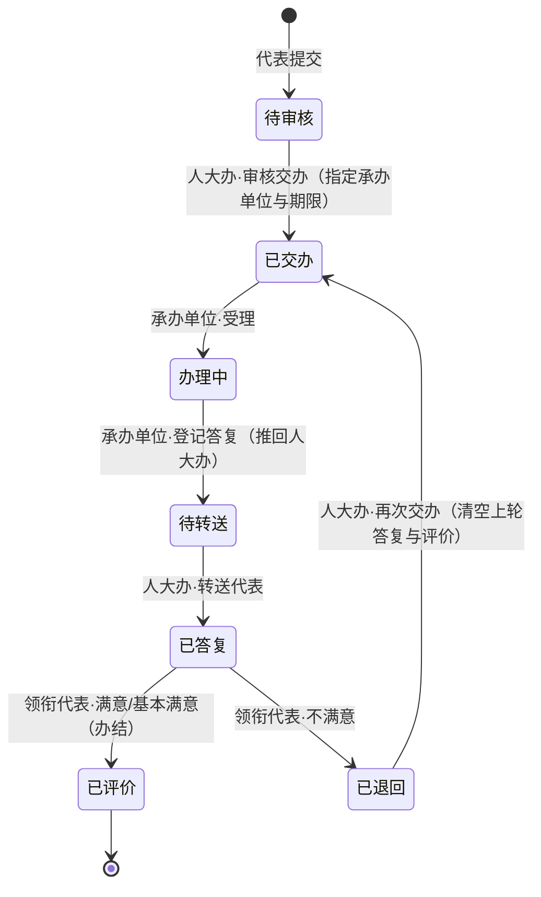

# 研究方法与系统实现过程

> 本章可作为毕业论文“系统设计与实现”部分（第 3～5 章）的素材，行文为第三人称学术表述，公式、图表与目录结构可直接引用。

## 1 研究方法概述

本系统的研制采用“需求调研—原型迭代—智能辅助开发—静态部署验证”的四阶段方法。

第一阶段，面向基层人民代表大会的日常工作开展需求调研，梳理出代表档案管理、履职活动管理与代表建议交办三类核心业务，并据此建立功能需求清单与非功能需求约束。第二阶段，采用原型迭代方法：先以最小可用原型验证页面结构与业务流程，再按“数据仪表盘—代表档案—活动管理—交办闭环—多方角色”的顺序逐轮扩充功能，每轮均以可运行的系统版本作为评审对象，使需求确认始终建立在可操作的界面上。第三阶段，在编码环节引入大语言模型辅助的智能编程助手：由其完成工程脚手架搭建、重复性组件代码生成与代码走查建议，开发者负责需求拆解、业务规则确认、生成代码的审查与修正，形成“人主导业务建模、模型辅助编码”的分工模式，从而在有限的本科开发周期内兼顾迭代速度与代码质量。第四阶段，采用静态站点托管方式完成部署验证，通过自动化流水线实现“提交即发布”，并以浏览器端黑盒测试验证系统行为。

上述方法的适用性在于：本系统以业务流程可视化与教学演示为目标，数据规模小、无隐私与并发压力，适合以轻量级前端方案快速交付可核验的成果。

## 2 需求分析

### 2.1 业务背景与调研

在乡镇（街道）一级，人民代表大会的日常工作主要由人大办（人大主席团）工作人员承担，其典型业务包括三类：

（1）**代表档案管理**。辖区镇级人大代表通常为数十名规模，其界别、所属镇街、任期、连任情况、联系方式等信息多以电子表格台账维护，存在检索不便、统计靠手工、换届衔接困难等问题。

（2）**履职活动管理**。调研视察、约见镇长、代表述职等活动需要登记参与代表并留存活动纪要，缺乏统一的过程记录载体，活动开展情况难以汇总呈现。

（3）**代表建议交办**。代表提出建议后，由人大办审核并交办给承办单位；承办单位受理、办理后向代表答复；人大办将答复转送领衔代表；代表对办理结果作满意度评价，评价不满意时退回重办。该流程环节多、涉及角色多，人工跟踪易遗漏办理期限，且难以回溯单件建议的完整办理轨迹。

调研结论：三类业务的共同痛点是“过程记录分散、办理状态不透明、统计分析依赖手工”，因此系统应以结构化台账与可视化呈现为核心目标。

### 2.2 功能需求

| 编号 | 模块 | 功能要点 | 优先级 |
|---|---|---|---|
| F1 | 登录 | 角色选择式模拟登录（管理员 / 人大代表 / 承办单位） | 高 |
| F2 | 数据仪表盘 | 统计卡与四类图表，仅管理员可见 | 高 |
| F3 | 代表档案 | 列表、筛选、分页、新增、编辑、删除、详情与履职画像、CSV 导出 | 高 |
| F4 | 活动管理 | 活动登记、编辑、删除、详情，按类型/状态/年份筛选，CSV 导出 | 高 |
| F5 | 建议交办 | 提交、审核交办、受理、登记答复、转送代表、满意度评价、退回重办，全程流转记录 | 高 |
| F6 | 我的待办 | 按角色统计待办数量，并支持一键跳转筛选 | 中 |
| F7 | 数据重置 | 一键恢复初始演示数据 | 中 |

### 2.3 非功能需求

（1）可演示性：系统可公开访问，打开链接即可按脚本完整演示；（2）可复现性：演示数据由固定随机种子生成，多次刷新结果一致；（3）零运维成本：不部署服务器端程序，静态托管即可运行；（4）本地化：全中文界面与中文业务注释，便于课程评审与后续维护。

## 3 总体架构与技术选型

### 3.1 总体架构

系统为浏览器端单页应用（SPA），采用三层组织：

```
表示层   React 组件（页面 / 布局 / 通用组件），基于 Ant Design 组件库
逻辑层   全局状态容器（Context + 动作函数），内聚角色权限判断、
         交办流程状态迁移、履职积分计算等业务规则
数据层   TypeScript 类型约束的内存数据 + localStorage 持久化
```

部署层为 GitHub Pages 静态托管：代码推送到 main 分支后，由 GitHub Actions 自动执行“安装依赖—类型检查—构建—发布”流水线。

### 3.2 技术选型

| 层面 | 选型 | 选型理由 |
|---|---|---|
| 构建工具 | Vite 5 | 开发服务器秒级热更新，内置 TypeScript 支持与生产构建 |
| 视图框架 | React 18 | 组件化成熟、生态完善，适合表格与表单密集的后台界面 |
| 开发语言 | TypeScript（strict 模式） | 以类型约束实体与状态枚举，在编译期拦截字段拼写与非法状态值 |
| 组件库 | Ant Design 5 | 表格、表单、抽屉、时间线等后台组件开箱即用，主题令牌可定制以贴合目标视觉风格 |
| 可视化 | ECharts 5 | 堆叠柱状、环形、条形与雷达图覆盖全部图表需求 |
| 路由 | react-router-dom（HashRouter） | 哈希路由不依赖服务器端重写规则，静态托管下刷新深层链接不产生 404 |
| 托管 | GitHub Pages + Actions | 免费公开访问，与代码仓库同源管理，提交即发布 |

### 3.3 无后端设计的原因

本阶段将系统定位为业务流程的可视化演示与验证载体：数据规模小（数十条记录）、使用者为单一演示者、无并发写入，采用浏览器端 localStorage 持久化即可满足全部演示需求。省去后端可显著降低部署与运维成本，使系统通过静态链接即可访问；其代价是数据不跨设备共享、无真实身份认证，相关限制与扩展方向见第 9 节。

## 4 数据模型与状态机

### 4.1 实体设计

系统抽象出五个核心实体（TypeScript 接口定义节选）：

```ts
interface User { id: string; name: string;
  role: 'admin' | 'deputy' | 'handler';      // 管理员 / 人大代表 / 承办单位
  deputyId?: string; handlerOrg?: string; }

interface Deputy { id: string; name: string; gender: '男' | '女'; birthYear: number;
  political: string; sector: string; town: string; level: string; termStart: number;
  consecutive: boolean; occupation: string; phone: string; email: string;
  address: string; joinDate: string; bio: string; contactVoters: number; }

interface Activity { id: string;
  type: '调研视察' | '约见镇长' | '代表述职' | '学习培训';
  title: string; date: string; location: string; organizer: string;
  participantIds: string[]; status: '计划中' | '已完成' | '已取消';
  summary: string; createdAt: string; }

interface Proposal { id: string; title: string; category: ProposalCategory;
  proposerId: string; cosponsorIds: string[]; submittedAt: string; content: string;
  status: ProposalStatus; handlerOrg?: string; assignedAt?: string; deadline?: string;
  reply?: string; repliedAt?: string; satisfaction?: Satisfaction; evaluatedAt?: string;
  flow: FlowRecord[]; }

interface FlowRecord { time: string; actor: string; action: string; note?: string; }
```

### 4.2 提案建议交办状态机

提案（建议）生命周期以显式状态机建模，每次状态迁移由特定角色触发，并向流转记录追加一条审计信息：



### 4.3 流转记录的审计式设计

每次状态迁移向 `Proposal.flow` 追加一条 FlowRecord（时间、操作者、动作、备注），时间线文案显式标注“谁推给谁”，例如“镇村镇建设服务中心受理”“承办单位提交答复，已推回人大办”“人大办已转送领衔代表，请评价”，以近乎零成本的附加信息获得单件建议办理轨迹的完全可追溯性。

## 5 关键实现方法

### 5.1 三层角色权限控制

权限控制分布于三个层面：其一，路由层按角色注册路由，未授权路径重定向至角色默认页；其二，菜单层按角色过滤左侧导航；其三，数据层与按钮层先按角色裁剪数据集合，再按“角色 × 当前状态”条件渲染操作按钮。以承办单位角色为例，其可见数据集合为 {p ∈ Proposals | p.handlerOrg = u.handlerOrg}，可用动作集合为 {受理 | p.status = 已交办} ∪ {登记答复 | p.status = 办理中}，从而在界面层面杜绝越权操作入口。

### 5.2 履职积分与雷达图

为量化代表个体履职情况，定义履职积分：

> S = 2·N_a + 3·N_p + N_t + 5·N_r + 0.2·N_c

式中 N_a 为参加活动场次（不含学习培训），N_p 为提出或附议建议件数，N_t 为参加学习培训场次，N_r 为代表述职场次，N_c 为联系群众次数。权重设定原则为：建议与述职的履职价值高于一般性出席，联系群众频次较高但单次权重较低。雷达图五个维度（活动参与、提案建议、学习培训、代表述职、联系群众）按各自满分向量 M = (20, 15, 10, 10, 50) 归一化至 0～100 区间：

> v_i' = min(100, round(100 · v_i / M_i))，i = 1, …, 5

### 5.3 浏览器端持久化

全局状态由 React Context 统一管理，全部业务动作以不可变方式更新状态，并经副作用钩子将全量数据同步至 localStorage（键 npc-deputy-db-v1）；应用启动时优先读取本地存储，读取失败或不存在时以固定种子 mock 数据初始化。“重置演示数据”动作删除该存储键后重新初始化，保证演示可随时回到确定起点。

### 5.4 固定种子的模拟数据

为使演示结果可复现，模拟数据不使用语言内置随机函数，而以 mulberry32 算法实现确定性伪随机数生成器，为 24 名代表、18 场活动与 20 件建议按固定种子生成；建议的交办状态按真实业务频率分布并覆盖全部七种状态，同时将生成序列中的前三件固定交办给同一承办单位，确保以承办单位角色登录即可完整演示受理与答复环节。

### 5.5 我的待办徽标

待办口径按角色定义：管理员为待审核、待转送、已退回三类之和；承办单位为本单位的已交办与办理中；代表为本人领衔且已答复未评价。顶栏以徽标（Badge）实时显示数量；点击后携带查询参数 `?todo=1` 跳转至建议列表，列表读取该参数并按当前角色的待办状态集合过滤，实现“数量—清单”联动。
## 6 可视化与“智能系统”体现

系统在三个层面体现可视化决策支持：其一，数据仪表盘以近 6 个月活动堆叠柱状图反映履职节奏，以分类环形图与办理状态条形图揭示建议的结构构成与瓶颈环节，以履职积分排行提供代表间的横向比较；其二，档案与活动列表提供多维条件筛选、关键词检索与 CSV 导出，替代人工台账的汇总统计工作；其三，详情抽屉以五维雷达图呈现代表个体的履职画像，以时间线呈现单件建议的完整办理轨迹，使管理者“看一张图、一条线即可掌握情况”。

在系统智能化方面，本阶段以“数据驱动 + 规则驱动”为基础：交办流程由显式状态机约束，履职评价由可解释的加权公式支撑，待办事项由角色化口径自动统计，均为可解释、可核验的规则智能。开发过程本身亦体现了智能辅助的应用：大语言模型辅助的智能编程助手承担了工程脚手架生成、样板组件编写、类型约定检查与文档起草等重复性工作，而业务建模、状态机设计与验收标准始终由开发者确定并逐项评审生成结果。受本科阶段条件限制，面向业务数据的机器学习类功能（如建议自动分类、相似建议检索、办理超期预测）未纳入本期实现，作为后续工作的主要方向。

## 7 实现过程

系统实现划分为七个阶段，各阶段均以可运行版本收尾：

| 阶段 | 目标 | 主要工作 | 阶段产出 |
|---|---|---|---|
| ① 工程初始化 | 搭建可运行骨架 | Vite + React + TypeScript 脚手架、主题令牌定制（青绿色系）、目录与类型约定 | 可访问的空壳系统 |
| ② 数据仪表盘 | 建立数据与图表基础 | 实体类型与固定种子 mock、ECharts 封装组件、统计卡与四张图表 | 管理员首页 |
| ③ 代表档案 | 完成档案主线 | 列表筛选分页、新增/编辑表单、详情抽屉与雷达画像、CSV 导出 | 档案管理页 |
| ④ 活动管理 | 完成活动主线 | 活动 CRUD、参与代表多选、类型配色与筛选 | 活动管理页 |
| ⑤ 交办闭环 | 实现核心业务 | 建议状态机与流转记录、按角色的动作按钮、满意度评价 | 提案建议页 |
| ⑥ 承办单位角色 | 补全多方协同 | 第三角色登录、数据范围裁剪、待转送状态与待办徽标 | 三角色完整闭环 |
| ⑦ 部署上线 | 公网可访问 | GitHub Actions 流水线、Pages 配置、README 与使用手册 | 公开演示地址 |

系统源码目录结构如下：

```
src/
├─ main.tsx / App.tsx        # 应用入口、路由与登录守卫
├─ theme.ts / index.css      # 主题令牌与全局样式
├─ types/index.ts            # 实体定义与交办状态机注释
├─ mocks/                    # 固定种子模拟数据（代表/活动/建议）
├─ store/AppStore.tsx        # 全局状态与业务动作（含流程状态迁移）
├─ utils/                    # CSV 导出、履职积分与雷达图计算
├─ components/               # ECharts 封装组件、指标卡
├─ layouts/AdminLayout.tsx   # 后台布局与“我的待办”徽标
└─ pages/                    # Login / Dashboard / Deputies / Activities / Proposals
```

## 8 部署与测试方法

### 8.1 构建与静态检查

生产构建前强制执行 `tsc --noEmit` 全量类型检查（strict 模式），通过后由 Vite 产出静态资源至 dist 目录。构建产物约 2.3 MB（gzip 后约 756 KB），对演示场景可以接受；如需优化可采用路由级代码分割，属工程优化范畴而非功能缺陷。

### 8.2 自动部署流水线

仓库内置 GitHub Actions 工作流，流水线步骤为：检出代码 → 安装 Node.js 20 → `npm ci` 还原依赖锁定的依赖树 → `npm run build`（类型检查 + 构建）→ 将 dist 目录作为 Pages 制品上传并发布。代码推送到 main 分支即自动触发，约 1～2 分钟完成发布。路由采用 Hash 模式，静态托管下刷新或分享深层链接不会产生 404，与 Pages 的目录式托管模型天然兼容。

### 8.3 功能测试

采用以业务流程为主线的黑盒测试方法，核心用例如下（节选）：

| 编号 | 前置条件 | 测试步骤 | 预期结果 |
|---|---|---|---|
| T1 | 管理员登录 | 打开数据仪表盘 | 统计卡与四张图表正常渲染 |
| T2 | 管理员登录 | 新增代表，界别输入新值 | 列表出现新档案；登录页代表下拉含该代表 |
| T3 | 管理员登录 | 删除任一档案并确认 | 档案移除；其历史建议仍可检索 |
| T4 | 管理员登录 | 对待审核建议执行审核交办 | 状态变更为已交办，时间线新增交办记录 |
| T5 | 承办单位登录 | 对本单位已交办件执行受理 | 状态变更为办理中，时间线显示“××受理” |
| T6 | 承办单位登录 | 对办理中件登记答复 | 状态变更为待转送 |
| T7 | 管理员登录 | 对待转送件转送代表 | 状态变更为已答复 |
| T8 | 领衔代表登录 | 对已答复件评价“满意” | 状态变更为已评价；改选“不满意”则变更为已退回 |
| T9 | 管理员登录 | 对已退回件再次交办 | 上轮答复与评价被清空，状态回到已交办 |
| T10 | 任意角色 | 点击顶栏“我的待办” | 跳转建议列表并按角色待办状态筛选 |

测试结论：上述用例全部通过；TypeScript 编译期类型检查在开发阶段即拦截了全部枚举与字段类缺陷，运行期未再出现同类错误。

### 8.4 发布验证

发布完成后使用公网地址验证：页面可正常访问，三种角色可完整走通交办闭环；若页面内容未更新，多为浏览器缓存所致，按 Ctrl+F5 强制刷新即可。

## 9 系统边界与后续工作

**系统边界**。本系统为单机演示版本，存在以下边界：（1）数据为固定种子模拟数据，存储于浏览器本地 localStorage，不支持多设备、多用户共享；（2）登录为角色选择式模拟，无真实身份认证与密码体系；（3）不包含真实公文流转、电子签章与消息通知能力；（4）数据规模按演示需要设定，未针对大数据量做分库分表等优化。

**后续工作**。（1）引入轻量级后端与真实鉴权体系，实现多用户、多设备的数据共享与细粒度权限管理；（2）增加办理超期提醒与消息通知（站内信、短信或企业微信）；（3）支持历史台账 Excel 批量导入导出，衔接既有工作习惯；（4）在数据积累基础上引入智能能力，如建议文本自动分类、相似建议检索、办理情况摘要生成，推动系统由“可视化决策支持”向“智能辅助办理”演进；（5）适配移动端，方便代表在手机端提交建议与作出评价。